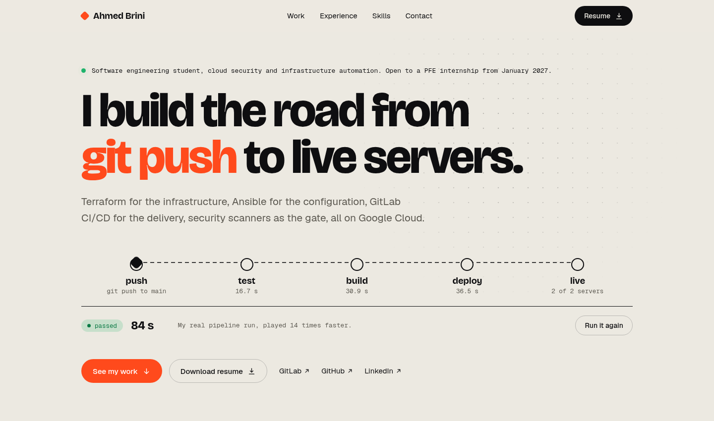
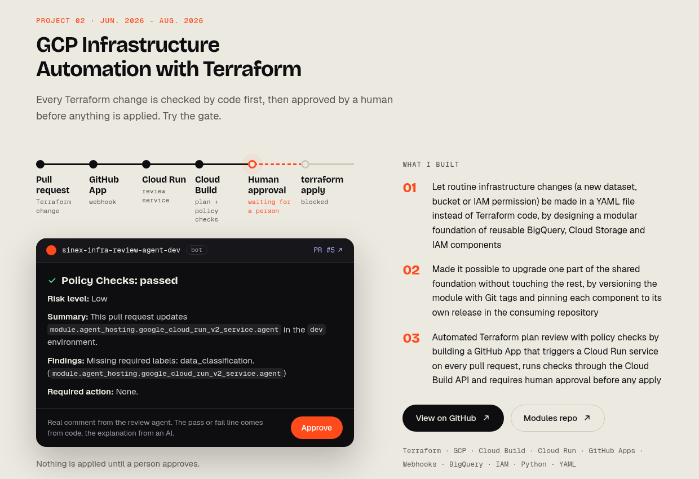

<p align="center">
  
</p>

# Ahmed Brini, portfolio

The personal site of Ahmed Brini, a software engineering student in Tunis focused on cloud security and infrastructure automation. It is open to a capstone internship (PFE) starting January 2027.

**Live:** https://ahmedbrini.vercel.app

## What is on the page

Three small interactive pieces, each built from real data from my own projects.

- **The hero pipeline.** It replays GitLab pipeline [#2911155655](https://gitlab.com/brinidev/gcp-delivery-pipeline/-/pipelines/2911155655) of `brinidev/gcp-delivery-pipeline` 14 times faster than it ran. It is an earlier run, from before the security scans were added. The step times (test 16.7 s, build 30.9 s, deploy 36.5 s) and the 84 s total are the real ones.
- **The scroll story.** As you scroll through the delivery project, a pipeline panel fills in step by step and shows the matching part of the real Ansible deploy log.
- **The Terraform approval gate.** It shows a real comment from the review agent on [PR #5](https://github.com/sinex-cloud/infrastructure-terraform-gcp/pull/5). The Approve button demonstrates how the flow works: nothing is applied until a person approves. It is a demo of the flow, not a live system.

<p align="center">
  
</p>

## How it is built

Plain HTML, CSS and JavaScript. There is no framework, no build step and no tracking. The fonts (Bricolage Grotesque, Geist and Geist Mono) load from Google Fonts. The animations turn off when the visitor's system asks for reduced motion.

## Run locally

```bash
python3 -m http.server 8765
```

Then open http://127.0.0.1:8765.

## Files

| File | What it is |
|---|---|
| `index.html` | All the content, plus a small inline SVG icon sprite |
| `styles.css` | Colors, layout and motion |
| `main.js` | The hero replay, the scroll story, the approval gate, the copy-email button |
| `og.html` → `og.png` | Social preview image (the regenerate command is in `og.html`) |
| `Ahmed_Brini_Resume.pdf` | The resume behind the download buttons |

## Deploy

Vercel deploys every push to `main`. `vercel.json` sets the framework to "Other", so there is no build step. It also redirects the old `/cv.pdf` link to the current resume.
